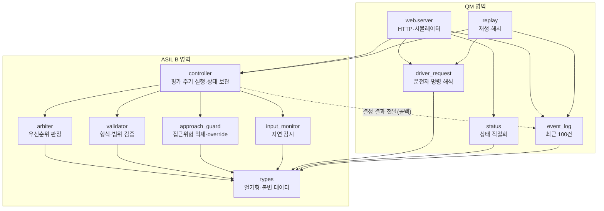
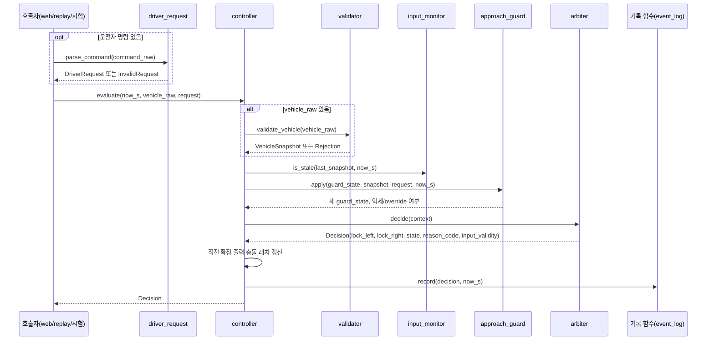
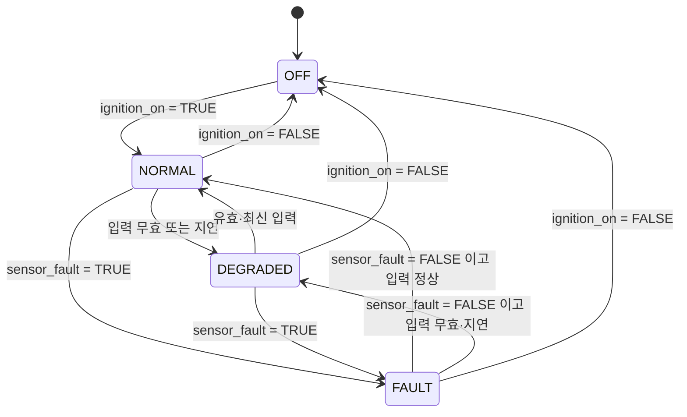

# SW 아키텍처 설계서 — 전자식 차일드락 제어 SW

| 항목 | 내용 |
|---|---|
| 문서 ID | SWA-001 |
| 베이스라인 | BL-SWA-1.0 (초안) |
| 상위 입력 | SWR-SPEC-001 (BL-SWR-1.0 초안), 가정 A-01~A-07 |
| A-SPICE | SWE.2 SW 아키텍처 설계 |
| 상태 | 초안 — 사용자 검토 전 |

## 1. 설계 원칙

| ID | 원칙 | 근거 |
|---|---|---|
| P-01 | 판단 로직은 순수 함수로 만들고, 상태는 컨트롤러 한 곳에서만 바꾼다 | 결정론(SWR-016), 단위 시험 용이 |
| P-02 | 시각은 호출자가 `now_s`로 넘긴다. 판단 로직은 시스템 시계를 읽지 않는다 | SWR-016, 지연 판정(SWR-013) 재현 |
| P-03 | ASIL B 모듈은 QM 모듈을 import하지 않는다 (의존 방향 QM → ASIL B 단방향) | 간섭 배제 (5절) |
| P-04 | 모듈 사이에 넘기는 데이터는 불변 객체(`frozen dataclass`, `Enum`)만 쓴다 | QM 모듈이 안전 판단 결과를 바꾸지 못하게 함 |
| P-05 | 출력 우선순위는 코드 분기가 아닌 순서 있는 규칙 목록으로 표현한다 | OEM 회신(Q-01)으로 순서가 바뀔 때 수정 범위 최소화, 함수 복잡도 10 이하 |
| P-06 | 외부 런타임 의존성 없이 표준 라이브러리만 쓴다 | DEC-02, SBOM 단순화 |

## 2. 정적 구조

### 2.1 모듈 구성

> 운전자 명령은 호출자(`web.server`, `replay`, 시험)가 `driver_request.parse_command`로 해석한 불변 결과(`DriverRequest` 또는 `InvalidRequest`)를 `controller`에 넘긴다. 따라서 ASIL B 모듈이 QM 모듈을 import하는 경우는 없다. 운전자 요청은 `arbiter`의 가장 낮은 순위(9)에서만 쓰이므로, QM 코드의 오류가 순위 1~8의 안전 판단을 바꿀 수 없다.
>
> `event_log`는 `controller`가 생성 시 주입받은 기록 함수로만 호출되며, `controller`는 `event_log` 모듈을 import하지 않는다.

### 2.2 모듈 책임

| 모듈 | ASIL | 책임 | 공개 인터페이스 (초안) |
|---|---|---|---|
| `types` | B | 열거형(Lock, State, ReasonCode, InputValidity, Side, Action, Source, CrashStatus, Gear), 불변 데이터(VehicleSnapshot, DriverRequest, Decision) | 데이터 정의만 |
| `validator` | B | 원시 차량 입력(dict) 검증 → `VehicleSnapshot` 또는 거절 사유 | `validate_vehicle(raw) -> VehicleSnapshot \| Rejection` |
| `input_monitor` | B | 스냅샷 지연 판정(> 0.200 s) | `is_stale(snapshot, now_s) -> bool` |
| `approach_guard` | B | 접근위험 시 해제 억제, 억제 시각 기록, 10.0 s 이내 재입력 override 판정 | `apply(guard_state, snapshot, request, now_s) -> (guard_state, events)` |
| `arbiter` | B | 우선순위 규칙 목록 평가 → 좌우 출력, 상태, 이유 코드 | `decide(context) -> Decision`, `RULES` |
| `controller` | B | 평가 주기 1회 실행, 직전 확정 출력·충돌 래치·가드 상태 보관, 결정 기록 함수 호출 | `ChildLockController.evaluate(now_s, vehicle_raw=None, request=None) -> Decision`, `last_decision` |
| `driver_request` | QM | 원시 운전자 명령 검증(side/action/source) → `DriverRequest` 또는 `InvalidRequest` (둘 다 `types`에 정의된 불변 객체) | `parse_command(raw) -> DriverRequest \| InvalidRequest` |
| `event_log` | QM | 이벤트 생성(허용 필드 7개), 최근 100건 링 버퍼, 메모리 전용 | `EventLog.record(decision, now_s)`, `EventLog.items()` |
| `status` | QM | `Decision` → 상태 조회 JSON (6개 필드) | `to_status(decision) -> dict` |
| `web.server` | QM | `http.server` 기반 API와 시뮬레이터 페이지, 선택적 50 ms 주기 tick | `GET /api/status`, `GET /api/events`, `POST /api/step`, `GET /` |
| `replay` | QM | 입력 벡터 파일 재생, 공개 결과 SHA-256 | `run(vectors) -> list[Decision]`, `digest(results) -> str` |

## 3. 동적 구조

### 3.1 평가 주기 (한 번의 `evaluate`)

- `vehicle_raw`가 없으면 마지막으로 받은 스냅샷으로 평가한다. 입력이 끊긴 상황(지연)을 주기 호출만으로 감지하기 위해서다.
- 상태 갱신은 `arbiter` 판정이 끝난 뒤 한 번에 한다. 기록 함수가 예외를 내도 판정과 상태 갱신은 이미 끝난 뒤다.

### 3.2 상태 기계

- 충돌 래치(SWR-007)는 상태와 별도 플래그로 보관하며 OFF 전이 때만 해제된다.
- 입력이 무효라 `ignition_on`을 알 수 없으면 직전 상태 판단을 유지한다(DEGRADED).

### 3.3 우선순위 판정

`arbiter.RULES`는 (조건 함수, 적용 함수, 이유 코드) 목록이며 SWR-019 표 순서와 같다. `decide`는 목록을 위에서부터 보며 쪽(left/right)별로 처음 해당하는 규칙을 적용한다. 양쪽에 함께 적용되는 규칙(순위 1~5, 8)은 양쪽을, 한쪽 규칙(6, 7, 9)은 해당 쪽만 결정한다. `Decision.reason_code`는 순위가 가장 높은 적용 규칙의 코드다.

## 4. 인터페이스

| 경계 | 형식 | 비고 |
|---|---|---|
| 차량 입력 (IF-001~003, 007~009) | JSON 객체 → dict | 필드명은 OEM IF 그대로. `timestamp_s`(=source_timestamp_s) 포함 |
| 운전자 명령 (IF-004) | JSON 객체 `{side, action, source}` | 시각은 스냅샷 시각 사용 |
| 출력 (IF-005) | `Decision.lock_left/right` | 논리 출력까지만 |
| 표시 (IF-006) | `GET /api/status` JSON | `priority_reason` = `reason_code` |
| 시험 주입 | `POST /api/step` `{now_s, vehicle?, command?}` | 응답은 상태 JSON |
| 이벤트 조회 | `GET /api/events` | 최근 100건, 오래된 순 |

## 5. 간섭 배제 (ASIL B ↔ QM)

ISO 26262-6을 교육용으로 부분 적용한다. PC/SIL 단일 Python 프로세스라 메모리·시간 분할은 제공할 수 없으며, 다음 설계 수단으로 대신한다.

| 간섭 유형 | 대응 |
|---|---|
| 데이터 오염 | ASIL B → QM 방향으로는 불변 객체만 전달 (P-04). QM이 받은 객체를 바꿀 수 없음 |
| 제어 흐름 | QM 결과(운전자 요청)는 최하위 순위에서만 사용. 기록 함수 호출은 판정·상태 갱신 이후 |
| 의존 방향 | ASIL B 모듈은 QM 모듈을 import하지 않음 (P-03, 예외 없음). 단위 시험에 import 방향 검사 시험을 넣어 자동 확인 |
| 시간 | 평가 1회가 주기(50 ms)보다 충분히 짧음을 통합 시험에서 측정 (목표: 1 ms 미만) |

**한계**: 같은 프로세스 안의 예외·자원 고갈은 막지 못한다. 양산 ECU 수준의 분할은 범위 밖이다.

## 6. 정적 분석 계획

| 항목 | 도구·방법 | 기준 | 시점 |
|---|---|---|---|
| 코딩 규칙·버그 패턴 | ruff (E, W, F, I, N, B, UP) | 경고 0 | 매 커밋, Jenkins |
| 순환 복잡도 | ruff C901 | 함수당 10 이하 | 매 커밋, Jenkins |
| 함수 길이 | `tools/check_function_length.py` | 순수 코드 50줄 이하 | 매 커밋, Jenkins |
| 주석률 | `tools/check_comment_ratio.py` | 파일별 20% 이상 | 매 커밋, Jenkins |
| 포맷 | ruff format | 차이 0 | 매 커밋, Jenkins |
| 의존 방향 | 단위 시험 `test_architecture.py` (AST로 import 검사) | ASIL B → QM import 0 | 4단계부터 |

## 7. 설계 결정

| ID | 결정 | 대안 | 이유 |
|---|---|---|---|
| AD-01 | 우선순위를 규칙 목록으로 표현 | if/elif 사슬 | 복잡도 10 이하 유지, Q-01 회신 시 순서만 변경 |
| AD-02 | `now_s`를 인자로 주입 | 모듈 내부에서 `time.monotonic()` | 결정론, 경계 시각 시험 |
| AD-03 | 이벤트 기록을 콜백으로 주입 | controller가 event_log 직접 import | ASIL B → QM 의존 제거 |
| AD-04 | Web 서버 주기 tick은 선택 옵션 | 항상 실행 | 시험·재생은 tick 없이 결정론적으로 구동 |
| AD-05 | 운전자 명령 해석은 호출자가 하고 결과 객체만 controller에 전달 | controller가 driver_request 호출 | ASIL B → QM import를 없애 간섭 배제 논리를 단순화 |

## 8. 추적: SWR → 아키텍처 요소

| SWR | 모듈 |
|---|---|
| SWR-001 | driver_request, arbiter |
| SWR-002 | driver_request, arbiter(`DRIVER_REQUEST_INVALID` 기록) |
| SWR-003 | arbiter |
| SWR-004 | arbiter, approach_guard |
| SWR-005 | approach_guard, arbiter |
| SWR-006 | approach_guard |
| SWR-007 | arbiter, controller(충돌 래치) |
| SWR-008 | arbiter |
| SWR-009 | arbiter |
| SWR-010 | event_log |
| SWR-011 | event_log |
| SWR-012 | event_log |
| SWR-013 | validator, input_monitor, controller |
| SWR-014 | status, web.server |
| SWR-015 | web.server |
| SWR-016 | controller, replay (전 모듈 P-01, P-02 준수) |
| SWR-017 | arbiter |
| SWR-018 | arbiter |
| SWR-019 | arbiter |
| SWR-020 | arbiter, controller(래치 해제) |
| SWR-021 | arbiter, controller(상태) |

**커버리지**: SWR 21/21이 1개 이상의 모듈에 할당됨. 모든 모듈이 1개 이상의 SWR을 가짐(`types`는 전 SWR 공통 데이터).
